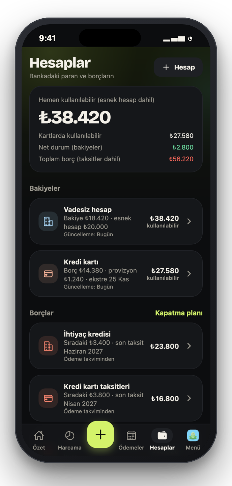

# Kumbara 🐢


Kişisel finans uygulaması: banka hesabın, kredi kartların, taksitlerin ve harcamaların tek yerde. Kumbara bugün hesabında ne olduğunu, maaş yatınca ve ödemeler düşünce ne kalacağını, her ay sonunda hesabının nerede olacağını gösterir.

Tek kod tabanıyla iOS, Android ve web; arka uç kendi sunucunda tek komutla (`docker compose up`) çalışır.

> **English:** Kumbara is a self-hostable personal finance app (iOS, Android, web) built with Expo and a Hono + PostgreSQL API. It tracks bank and card balances, installment plans and spending, and projects your balance month by month. The UI and docs are in Turkish; contributions in English are welcome. Run `docker compose up -d --build` and open http://localhost:8080; see [Kendi sunucunda kurulum](#kendi-sunucunda-kurulum) before exposing it to the internet and [LICENSE](LICENSE) (MIT).

## Ekranlar

| Özet | Harcama ekle | Ödemeler |
|:---:|:---:|:---:|
|  |  |  |
| Bakiye, kart borcu, maaş yatınca ve ödemeler düşünce kalan | Telefona uygun tuş takımı, kategori ve ödeme aracı | Ay ay plan; taksitler kart ekstresinin içinde |
| **Harcamalar** | **Hesaplar** | **Açık tema** |
|  |  |  |
| Aylık toplam, kategori dağılımı ve geçen ayla kıyas | Banka, kart, limit ve borçlar tek yerde | Koyu ve açık tema |

Görsellerdeki tüm kişi ve tutarlar örnektir.

## Özellikler

- **Özet:** banka bakiyesi, kart borcu ve kart dahil net durum; sıradaki maaş yatınca ve sonraki maaşa kadarki ödemeler düşünce hesapta kalan; önümüzdeki ay sonlarının tahmini
- **Ödemeler:** takvim ayına göre plan; kredi kartı taksitleri ait oldukları ekstrenin içinde, krediler ayrı; banka uygulamasındaki taksit listesini yapıştırarak ekleme; maaş geliri ve her ay sonunda hesapta kalan
- **Hesaplar:** banka, kredi kartı ve nakit hesapları; esnek hesap (KMH), kart limiti, provizyon ve ekstre; eksi bakiye ve taksit kaynakları Borçlarım'a kendiliğinden düşer
- **Harcama ekle:** telefona uygun tuş takımı (web'de klavye de çalışır), kategori, ödeme aracı (kart borcuna ya da hesap bakiyesine yansır), favoriler, `#etiket`ler
- **Harcamalar:** ay ay toplam, kategori dağılımı, en çok harcanan yerler, geçen ayla kıyas ve tasarruf önerileri; tüm hareketlerde arama
- **Sabit giderler:** kira, aidat, abonelik gibi aylık ödemeler; ödeme günü, başlangıç tarihi ve erken ödenen ayın plana iki kez girmemesi
- **Birikim hedefleri**, **ortak alan** (davet koduyla paylaşılan bütçe ve hesaplaşma), **CSV içe aktarma**, **JSON yedek ve geri yükleme**
- **Çevrimdışı kullanım:** internet yokken eklenen harcamalar sıraya alınır, bağlantı gelince gönderilir
- **Bildirimler, widget'lar, kısayollar, Apple Watch** ve iOS Canlı Etkinlik
- **Giriş:** e-posta, Apple ve Google; kayıt olmadan örnek verilerle deneme

Tutarlar veritabanında kuruş cinsinden tamsayı olarak tutulur.

## Yapı

```
apps/
  api/      Hono + Drizzle ORM + PostgreSQL (Node 24), Vitest testleri
  mobile/   Expo SDK 58 + Expo Router (iOS / Android / web), web için nginx imajı
e2e/        Playwright ile derlenmiş web uygulamasında uçtan uca testler
docker-compose.yml   db + api + web + gece yedeği
```

## Yerelde çalıştırma

PostgreSQL gerekmez: `DATABASE_URL` tanımlı değilse API gömülü PGlite kullanır (`apps/api/.pglite`).

```bash
cd apps/api && npm install && npm run dev
```

```bash
cd apps/mobile && npm install && npx expo start
```

Expo terminalinde `w` web'i açar. API adresi geliştirmede varsayılan olarak `http://localhost:3000`; değiştirmek için `apps/mobile/.env.example` dosyasını `.env` olarak kopyala.

Geliştirme ortamında Kumbara+ özellikleri Menü › Kumbara+ › "Kumbara+'ı dene (geliştirme)" ile açılır. Bu düğme yalnızca `NODE_ENV=development` ya da `test` iken (veya `ALLOW_DEV_BILLING=1` ile) çalışır.

Bildirimler, widget, kısayollar, Apple ile giriş ve satın alma yerel modül gerektirir; Expo Go'da değil, geliştirme derlemesinde çalışır:

```bash
cd apps/mobile && npx eas-cli@latest build --profile development --platform ios
```

## Testler

```bash
cd apps/api && npm test          # API testleri, bellek içi veritabanıyla
```

```bash
cd e2e && npm install && npx playwright install chromium && npx playwright test
```

Uçtan uca testler API'yi ve derlenmiş web uygulamasını kendileri başlatır. Web sunucusu üretimdeki güvenlik başlıklarını (`apps/mobile/security-headers.conf`) kullanır; bir değişiklik Content Security Policy'ye takılırsa testler düşer.

Yerel uygulama akışları için Maestro senaryoları `apps/mobile/.maestro/` altındadır.

GitHub Actions (`.github/workflows/ci.yml`) her gönderimde API testlerini, mobil tip kontrolü ve lint'i, uçtan uca testleri ve Docker derlemelerini çalıştırır.

## Hızlı başlangıç

Docker yeterli; hiçbir ayar gerekmez:

```bash
git clone <bu depo> kumbara && cd kumbara
docker compose up -d --build
```

Uygulama http://localhost:8080 adresinde açılır. Hesap oluşturabilir ya da "Kayıt olmadan örnek verilerle dene" ile örnek verilerle başlayabilirsin. Veritabanı tabloları API ilk açıldığında oluşturulur.

## Kendi sunucunda kurulum

İnternete açmadan önce:

1. `.env.example` dosyasını `.env` olarak kopyala ve en az şunları doldur:
   - `POSTGRES_PASSWORD`: uzun ve rastgele bir veritabanı şifresi
   - `APP_URL`: uygulamanın genel adresi, ör. `https://kumbara.example.com` (şifre sıfırlama bağlantıları bu adresle gönderilir)
2. `docker compose up -d --build`
3. Önüne TLS sonlandıran bir ters vekil koy (Caddy, Traefik, nginx) ve yalnızca `web` servisine (varsayılan 8080) yönlendir. `/api` istekleri web içindeki nginx tarafından `api` servisine iletilir; veritabanı ve API dışarı açılmaz.
4. `backup` servisi her gece yedek alır (7 gün, 4 hafta, 6 ay). Geri yüklemek için:
   `gunzip -c /backups/daily/kumbara-….sql.gz | docker compose exec -T db psql -U kumbara kumbara`

[Coolify](https://coolify.io) gibi panellerde depoyu "Docker Compose" kaynağı olarak ekleyip aynı değişkenleri panelden tanımlayabilirsin; bu durumda `web` servisine alan adı ver.

İsteğe bağlı ayarlar:

| Özellik | Sunucu (`api`) | Uygulama (`EXPO_PUBLIC_…`) |
|---|---|---|
| Şifre sıfırlama e-postası | `SMTP_URL`, `MAIL_FROM` | — |
| Google ile giriş | `GOOGLE_CLIENT_IDS` | `GOOGLE_WEB_CLIENT_ID`, `GOOGLE_IOS_CLIENT_ID`, `GOOGLE_ANDROID_CLIENT_ID` |
| Apple ile giriş | `APPLE_CLIENT_IDS` (paket kimliği) | — |
| Kumbara+ | `RC_WEBHOOK_SECRET` (RevenueCat webhook'u: `https://…/api/webhooks/revenuecat`) | `RC_IOS_KEY`, `RC_ANDROID_KEY` |
| Push bildirimleri | `EXPO_ACCESS_TOKEN` | EAS proje kimliği (`npx eas-cli@latest init`) |
| Hata takibi | `SENTRY_DSN` | `SENTRY_DSN`; kaynak eşlemesi için `SENTRY_ORG`, `SENTRY_PROJECT`, `SENTRY_AUTH_TOKEN` |

`SMTP_URL` tanımlı değilse şifre sıfırlama bağlantıları API günlüğüne yazılır; üretimde SMTP tanımlaman önerilir. Güvenlikle ilgili diğer notlar için [SECURITY.md](SECURITY.md).

## Mobil uygulama derlemesi

Kendi derlemen için:

1. `npx eas-cli@latest init` ile kendi EAS projeni oluştur; hesabını ve proje kimliğini `app.json`'a ekler.
2. `app.json` içindeki paket kimliklerini (`com.kumbara.app`) kendine ait bir kimlikle değiştir (mağazada yayımlayacaksan zorunlu).
3. API adresini EAS'e tanımla: `npx eas-cli@latest env:create --name EXPO_PUBLIC_API_URL --value https://kumbara.example.com`
4. Android için `google-services.json` dosyasını EAS'e gizli dosya olarak (`GOOGLE_SERVICES_JSON`) yükle; depoya koyma.

```bash
cd apps/mobile && npx eas-cli@latest build --platform all
```

Apple Watch uygulaması `apps/mobile/targets/watch` altındadır. Sunucu adresi `targets/watch/Info.plist` içindeki `KumbaraAPIURL` anahtarındadır; derlemek için `app.json` içinde `ios.appleTeamId` tanımlanmalıdır.

## Veritabanı şeması değişikliği

```bash
cd apps/api && npm run db:generate
```

Yeni migration dosyası `apps/api/drizzle/` altına yazılır ve API bir sonraki açılışta uygular.

## Katkı

Katkılar memnuniyetle karşılanır; ayrıntılar [CONTRIBUTING.md](CONTRIBUTING.md) içinde. Güvenlik açığı bildirimleri için lütfen herkese açık issue açma, [SECURITY.md](SECURITY.md) adımlarını izle.

## Lisans

[MIT](LICENSE)
