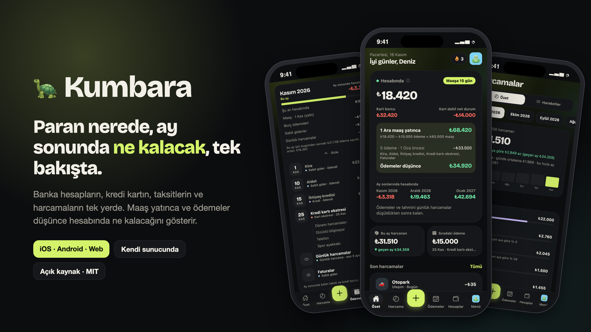
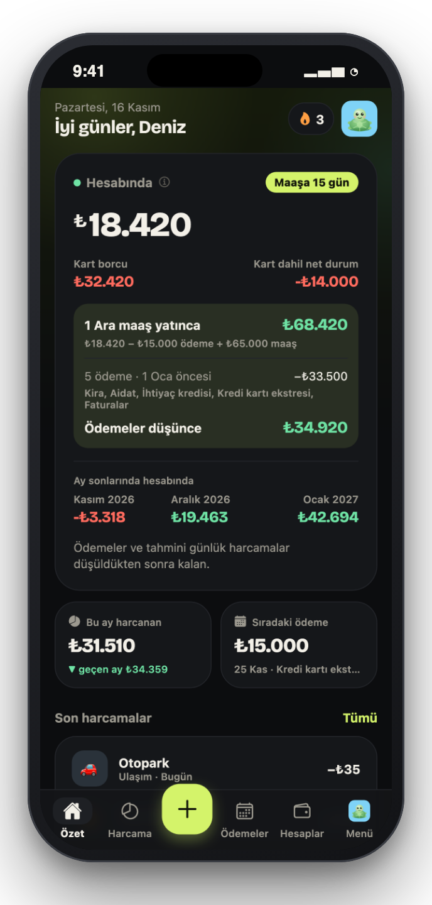
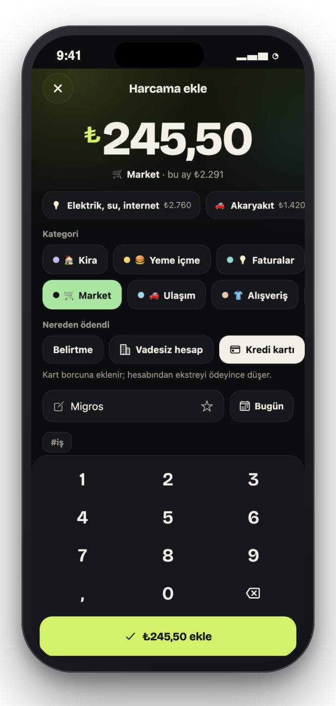
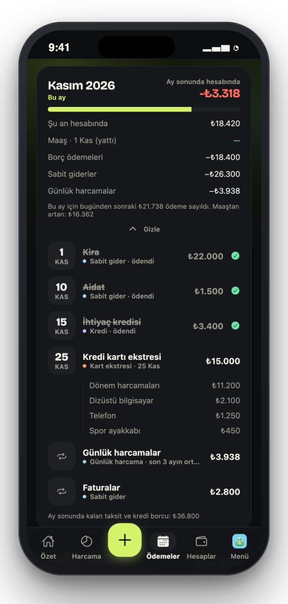
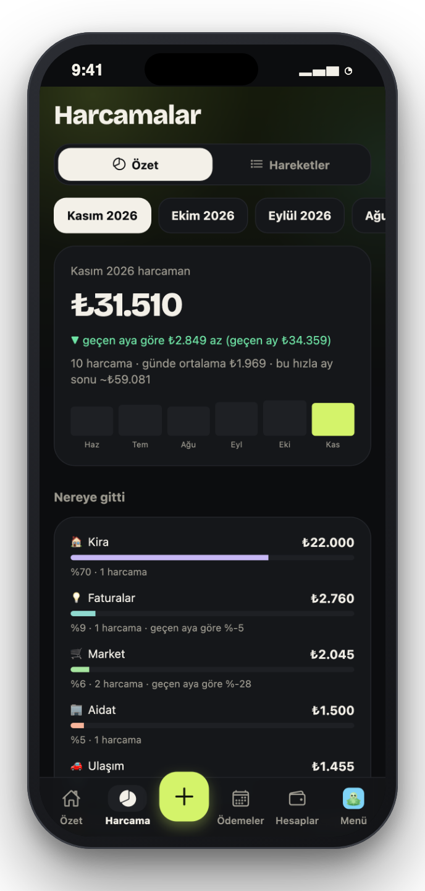
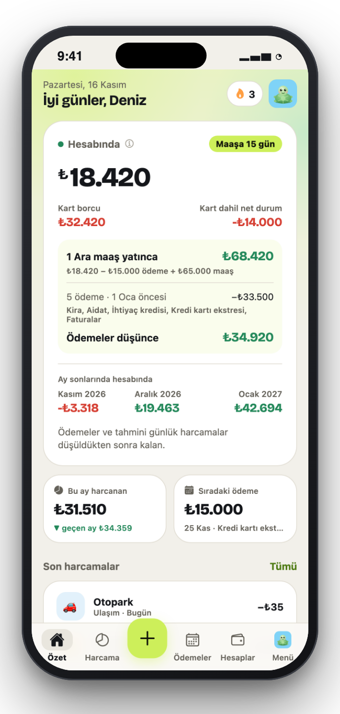

<p align="right"><b>English</b> · <a href="README.tr.md">Türkçe</a></p>

# Kumbara 🐢



A personal finance app that puts your bank accounts, credit cards, installments and spending in one place. Kumbara shows what is in your account today, what will be left once your salary arrives and your payments go out, and where your balance will be at the end of each month.

One codebase for iOS, Android and the web. The backend runs on your own server with a single command (`docker compose up`).

> The app's interface is currently in Turkish (amounts in Turkish lira). Translations are welcome; see [Contributing](#contributing).

## Screens

| Overview | Add expense | Payments |
|:---:|:---:|:---:|
|  |  |  |
| Balance, card debt, and what is left after payday and upcoming payments | Phone-friendly keypad, category and payment method | Month-by-month plan; installments shown inside the card statement |
| **Spending** | **Accounts** | **Light theme** |
|  |  |  |
| Monthly total, category breakdown and comparison with last month | Bank, card, limits and debts in one place | Dark and light themes |

All people and amounts in the screenshots are fictional.

## Features

- **Overview:** bank balance, card debt and net position including cards; what will be left after the next payday and after the payments due before the following one; projected balance at the end of the coming months
- **Payments:** a calendar-month plan; credit card installments are shown inside the statement they belong to, loans separately; add installments by pasting the list from your banking app; salary income and the balance left at the end of every month
- **Accounts:** bank, credit card and cash accounts; overdraft, card limit, pending transactions and statements; negative balances and installment plans flow into Debts automatically
- **Add expense:** a phone-friendly keypad (the keyboard works on the web), category, payment method (adds to card debt or reduces the bank balance), favourites and `#tags`
- **Spending:** monthly totals, category breakdown, top places, comparison with last month and saving tips; search across all transactions
- **Fixed costs:** rent, building fees, subscriptions and other monthly payments, with a due day, a start date, and early payments counted only once in the plan
- **Savings goals**, **shared spaces** (a budget shared through an invite code, with settle-up), **CSV import**, **JSON backup and restore**
- **Offline use:** expenses added without a connection are queued and sent when you are back online
- **Notifications, widgets, shortcuts, Apple Watch** and iOS Live Activities
- **Sign-in:** email, Apple and Google; try it with sample data without signing up

Amounts are stored as integer kuruş (1/100 of a lira).

## Quick start

All you need is Docker; no configuration required:

```bash
git clone https://github.com/utkumeydan/kumbara.git && cd kumbara
docker compose up -d --build
```

Open http://localhost:8080. Create an account, or start with sample data via "Kayıt olmadan örnek verilerle dene" (try without signing up). Database tables are created the first time the API starts.

## Self-hosting

Before exposing it to the internet:

1. Copy `.env.example` to `.env` and set at least:
   - `POSTGRES_PASSWORD`: a long, random database password
   - `APP_URL`: the public address of the app, e.g. `https://kumbara.example.com` (used in password reset links)
2. `docker compose up -d --build`
3. Put a TLS-terminating reverse proxy in front (Caddy, Traefik, nginx) and route it only to the `web` service (port 8080 by default). The nginx inside `web` forwards `/api` requests to the `api` service; the database and the API are not exposed.
4. The `backup` service takes a backup every night (kept for 7 days, 4 weeks and 6 months). To restore:
   `gunzip -c /backups/daily/kumbara-….sql.gz | docker compose exec -T db psql -U kumbara kumbara`

On panels such as [Coolify](https://coolify.io), add the repository as a "Docker Compose" resource, set the same variables in the panel and assign your domain to the `web` service.

Optional settings:

| Feature | Server (`api`) | App (`EXPO_PUBLIC_…`) |
|---|---|---|
| Password reset email | `SMTP_URL`, `MAIL_FROM` | — |
| Sign in with Google | `GOOGLE_CLIENT_IDS` | `GOOGLE_WEB_CLIENT_ID`, `GOOGLE_IOS_CLIENT_ID`, `GOOGLE_ANDROID_CLIENT_ID` |
| Sign in with Apple | `APPLE_CLIENT_IDS` (bundle identifier) | — |
| Kumbara+ | `RC_WEBHOOK_SECRET` (RevenueCat webhook: `https://…/api/webhooks/revenuecat`) | `RC_IOS_KEY`, `RC_ANDROID_KEY` |
| Push notifications | `EXPO_ACCESS_TOKEN` | EAS project ID (`npx eas-cli@latest init`) |
| Error tracking | `SENTRY_DSN` | `SENTRY_DSN`; for source maps `SENTRY_ORG`, `SENTRY_PROJECT`, `SENTRY_AUTH_TOKEN` |

Without `SMTP_URL`, password reset links are written to the API log; configure SMTP in production. See [SECURITY.md](SECURITY.md) for other security notes.

## Project structure

```
apps/
  api/      Hono + Drizzle ORM + PostgreSQL (Node 24), Vitest tests
  mobile/   Expo SDK 58 + Expo Router (iOS / Android / web), nginx image for the web
e2e/        Playwright end-to-end tests against the built web app
docker-compose.yml   db + api + web + nightly backup
```

## Running locally

No PostgreSQL needed: without `DATABASE_URL` the API uses embedded PGlite (`apps/api/.pglite`).

```bash
cd apps/api && npm install && npm run dev
```

```bash
cd apps/mobile && npm install && npx expo start
```

Press `w` in the Expo terminal to open the web app. In development the API address defaults to `http://localhost:3000`; to change it, copy `apps/mobile/.env.example` to `.env`.

In development, Kumbara+ features can be enabled from Menü › Kumbara+ › "Kumbara+'ı dene (geliştirme)". The button only works with `NODE_ENV=development` or `test` (or `ALLOW_DEV_BILLING=1`).

Notifications, widgets, shortcuts, Sign in with Apple and purchases need native modules, so they run in a development build rather than Expo Go:

```bash
cd apps/mobile && npx eas-cli@latest build --profile development --platform ios
```

## Tests

```bash
cd apps/api && npm test          # API tests with an in-memory database
```

```bash
cd e2e && npm install && npx playwright install chromium && npx playwright test
```

The end-to-end tests start the API and the built web app themselves. The test web server sends the production security headers (`apps/mobile/security-headers.conf`), so a change that trips the Content Security Policy fails the tests.

Maestro flows for the native app live in `apps/mobile/.maestro/`.

GitHub Actions (`.github/workflows/ci.yml`) runs the API tests, mobile type check and lint, the end-to-end tests and the Docker builds on every push.

## Building the mobile app

For your own build:

1. Create your own EAS project with `npx eas-cli@latest init`; it adds your account and project ID to `app.json`.
2. Replace the bundle identifiers in `app.json` (`com.kumbara.app`) with your own (required to publish to the stores).
3. Set the API address in EAS: `npx eas-cli@latest env:create --name EXPO_PUBLIC_API_URL --value https://kumbara.example.com`
4. For Android, upload `google-services.json` to EAS as a secret file (`GOOGLE_SERVICES_JSON`); never commit it.

```bash
cd apps/mobile && npx eas-cli@latest build --platform all
```

The Apple Watch app lives in `apps/mobile/targets/watch`. Its server address is the `KumbaraAPIURL` key in `targets/watch/Info.plist`; building it requires `ios.appleTeamId` in `app.json`.

## Database schema changes

```bash
cd apps/api && npm run db:generate
```

The new migration is written to `apps/api/drizzle/` and applied the next time the API starts.

## Contributing

Contributions are welcome; see [CONTRIBUTING.md](CONTRIBUTING.md). Please do not report security issues in public issues; follow [SECURITY.md](SECURITY.md) instead.

## License

[MIT](LICENSE)
